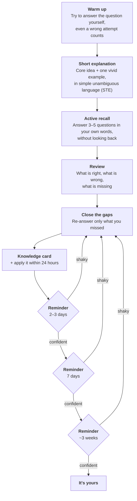

# Learning Coach

A Claude skill that turns any topic or work chat into knowledge that sticks.

---

**You read it. It made sense. A week later it's gone.**

If any of these sound like you, this skill is for you:

- You read the explanation, it all clicked — and tomorrow you can't explain it yourself.
- You re-read the same chapter "just in case" and still forget it.
- You highlighted half the page and remember none of it.
- You got a great answer from Claude, trusted the chat to keep it... and the chat is the only place it lives.

That's not a bad memory. That's what plain reading does. Your brain strengthens what it *retrieves*, not what it sees. Reading feels like learning because the text looks familiar — but recognition is not recall. And with an AI it's even easier to fool yourself: Claude has the answer in front of it like a cheat sheet, so it can "know" everything it was told. You can't. You have to build the knowledge into your own memory.

Nothing new sticks just because you read it. It has to be **anchored in you**: retrieved, explained in your own words, applied, and revisited right when you're about to forget it. Otherwise it evaporates, no matter how many times you scroll up.

**Learning Coach makes Claude a coach instead of a lecturer.** You try first. You recall without scrolling up. Your mistakes get reviewed. And the questions come back at you after you've partly forgotten — exactly when coming back does the most work. What you want to remember, you actually remember.

## What it does

| Mode | When | What happens |
|---|---|---|
| **Learn a topic** | You want to learn something new | You attempt an answer, get a short explanation, then recall it in your own words |
| **Consolidate a chat** | Real work just happened in the chat | Claude picks 3–7 things worth owning (mechanisms, decisions, bug causes) and quizzes you on the ones you choose |
| **Review** | A reminder fired, or you paste a card into a new chat | Claude checks your answers against the card's key and sets a longer interval |

Learn and Consolidate sessions end with:

- **A knowledge card.** It carries its own questions and answer key, so a review works in any new chat.
- **One thing to apply** within 24 hours.
- **Review reminders** after 2–3 days and 7 days, then about 3 weeks later if your answers were confident. Claude uses your calendar connector if you have one. Otherwise, it gives you the dates and text to paste.

Questions adapt to the field: code, research, languages, business processes, math and decisions. The skill replies in your language.

**Explanations and cards follow ASD-STE100** (Simplified Technical English): short sentences, one word — one meaning, active voice. See [references/ste.md](references/ste.md).

It won't turn your work chat into a lesson. When a topic you showed interest in wraps up, Claude offers once to consolidate it. If you say no, it moves on.

## The loop

Every Learn and Consolidate session runs the same loop — the only difference is where the material comes from:



The interval grows while your answers stay confident; shaky answers loop back until the gaps close. Standalone versions: [docs/learning-loop.mmd](docs/learning-loop.mmd) (Mermaid source) and [docs/learning-loop.svg](docs/learning-loop.svg) (image).

## What a session looks like

An illustrative example of **Consolidate a chat**, after fixing a slow page:

> **You:** Thanks, the N+1 is gone.
>
> **Claude:** There were a few new things here: N+1 queries and eager loading. Want to lock them in? 5 minutes: I'll ask 3–4 questions and set review reminders.
>
> **You:** Now.
>
> **Claude:** Worth keeping: why N+1 happens, how eager loading fixes it, when eager loading backfires. All three?
>
> **You:** Yes.
>
> **Claude:** Answer in your own words, without scrolling up. Short is fine, mistakes are fine.
> 1. Why did the page run 101 queries for 100 orders?
> 2. How does eager loading change that?
> 3. When does eager loading make things worse?
>
> **You:** 1. One query for the orders, then one for each customer. 2. It loads the customers together with the orders. 3. No idea.
>
> **Claude:** 1 and 2 are right. 3 is the gap: you pay for related rows even on pages that never show them. Now answer 3 again in your own words.

The session ends with a card like this:

```
Topic: N+1 queries · created 2026-11-06
Context: slow orders page in my shop project

Questions (answer without hints):
1. Why did the page run 101 queries for 100 orders?
2. How does eager loading change that?
3. When does eager loading make things worse?

Answer key — don't look before answering:
1. One query for the list, then one lazy query per row for the customer.
2. It fetches the related rows up front, with a join or one extra query.
3. When the page doesn't use the relation: you pay for data nobody sees.

Apply: find one more list page in your project and count its queries.
Reviews: 2026-11-09, 2026-11-13
```

## Install

### Claude Code

```bash
git clone https://github.com/eeephemera/learning-coach "$HOME/.claude/skills/learning-coach"
```

This command works in bash, zsh and PowerShell. If `~/.claude/skills` didn't exist when your session started, run `/reload-skills`.

To update:

```bash
git -C "$HOME/.claude/skills/learning-coach" pull
```

### Claude app (web and desktop)

1. Download [learning-coach.zip](https://github.com/eeephemera/learning-coach/releases/latest/download/learning-coach.zip). Don't unzip it.
2. Open **Customize > Skills**, click **+**, then choose **Create skill > Upload a skill** and pick the file.

Skills need code execution. If the upload isn't available, turn on **Code execution and file creation** (or **Create and edit files**) in **Settings > Capabilities**.

## Try it

- `Help me learn how database indexes work. I want this to stick.`
- `What did I learn from this chat? Quiz me.`
- `Let's review.` followed by your knowledge card

## Why it works

- **Recall beats rereading.** Testing improved delayed retention more than restudying ([Roediger & Karpicke, 2006](https://doi.org/10.1111/j.1467-9280.2006.01693.x)).
- **Trying first helps, even when the try fails** ([Kornell, Hays & Bjork, 2009](https://doi.org/10.1037/a0015729)).
- **Spacing beats cramming** ([Cepeda et al., 2006](https://doi.org/10.1037/0033-2909.132.3.354)).
- **Sleep supports memory consolidation** ([Rasch & Born, 2013](https://doi.org/10.1152/physrev.00032.2012)).
- **The overall ranking.** A review of ten study techniques rated practice testing and distributed practice as high utility, and rereading and highlighting as low utility ([Dunlosky et al., 2013](https://doi.org/10.1177/1529100612453266)).

The exact intervals and the 24-hour rule are practical defaults, not findings from these papers. [references/theory.md](references/theory.md) has the longer explanation that the skill gives to users.

## License

[MIT](LICENSE)
